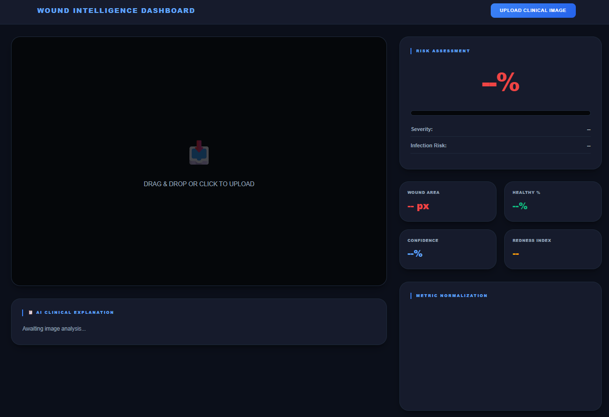
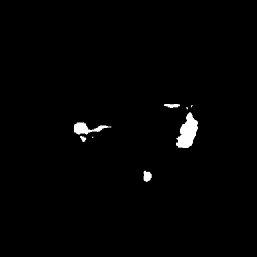
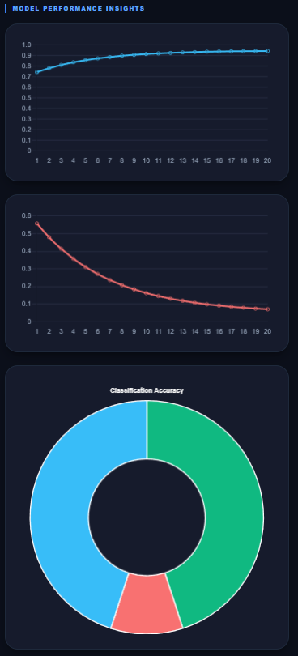
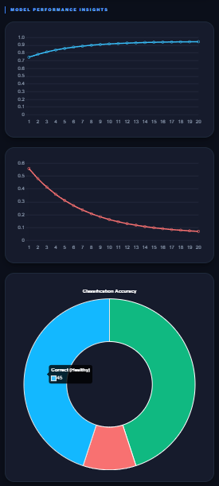

# 🧠 AI-Based Wound Intelligence & Risk Assessment System

AI-powered wound analysis system using deep learning for segmentation, tissue analysis, and risk assessment.

---

## 🚀 Features

- 🔍 **Automated Segmentation**: High-precision wound boundary detection using PyTorch.
- 📊 **Tissue Analysis**: Real-time extraction of metrics (Area, Redness, Compactness).
- ⚠️ **Risk Scoring**: Multi-factor clinical risk assessment and severity classification.
- 🧠 **AI Explanation**: Local LLM integration (Ollama) providing human-friendly reports.
- 🌐 **Web Dashboard**: Modern, responsive dark-themed interface for clinical use.

---

## 📊 Dashboard Preview



---

## 🔍 Segmentation Visualization

| Original | Mask | Overlay |
|---------|------|--------|
|  |  |  |

---

## 📈 Model Performance

| Accuracy Profile | Convergence Loss |
|---------------|-------------------|
|  |  |

---

## 🛠️ Tech Stack

- **Backend**: Python, FastAPI, PyTorch, OpenCV
- **Frontend**: HTML5, CSS3 (Modern Dark Theme), JavaScript
- **Charts**: Chart.js
- **LLM**: Ollama (llama3)

---

## 📁 Project Structure

```text
project_root/
├── app.py              # FastAPI Backend Entry
├── core/
│   ├── inference.py    # AI Model Inference Pipeline
│   └── analysis.py     # Metrics & AI Report Logic
├── models/
│   └── best_model.pth  # Model Weights
├── static/             # Web Assets (CSS/JS)
├── templates/          # HTML UI
├── assets/             # Documentation Screenshots
├── requirements.txt    # Python Dependencies
└── README.md           # Product Documentation
```

---

## ⚙️ Setup & Installation

1. **Clone the Repository**:
   ```bash
   git clone https://github.com/projectbin07-stack/wound-analysis-aiml.git
   cd wound-analysis-aiml
   ```

2. **Install Dependencies**:
   ```bash
   pip install -r requirements.txt
   ```

3. **Model Weights**:
   Ensure `best_model.pth` is in the `models/` directory.

4. **Run the Application**:
   ```bash
   python app.py
   ```
   Open **http://127.0.0.1:8001** in your browser.

---
*Disclaimer: This tool is for research and demonstration. Always consult a healthcare professional for clinical diagnosis.*
