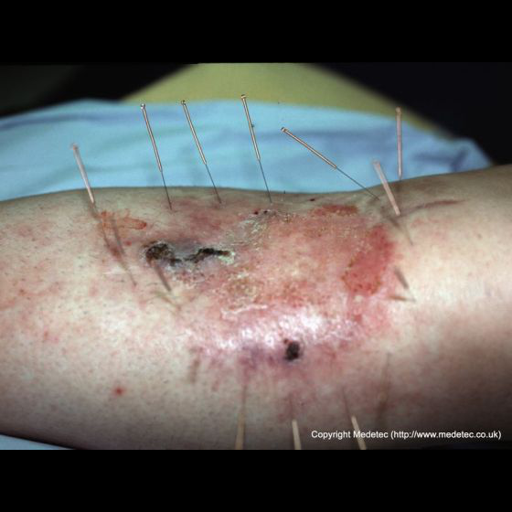
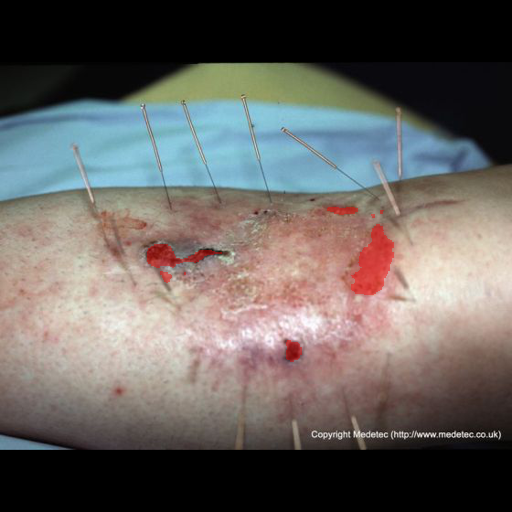
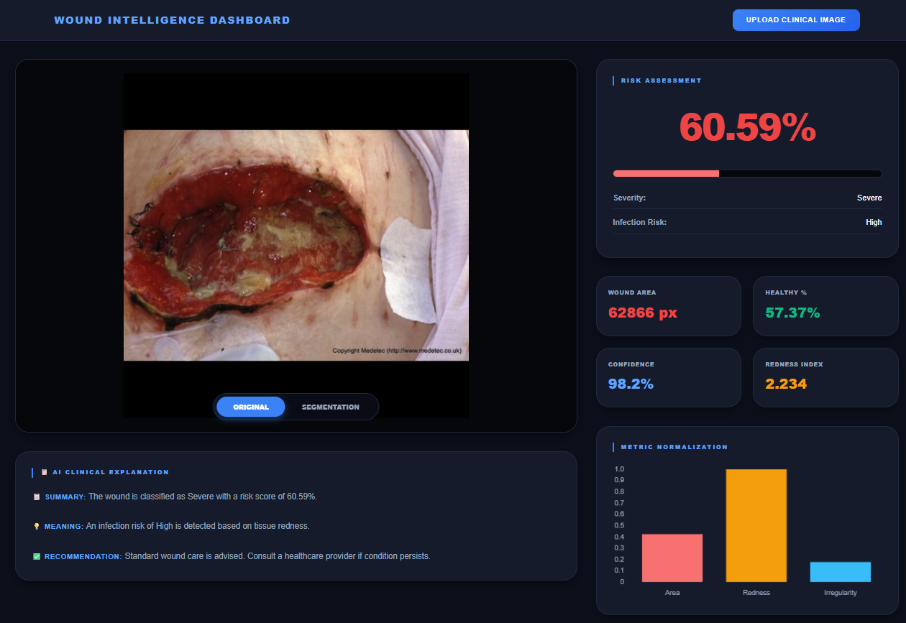

# 🧠 AI-Based Wound Intelligence & Risk Assessment System

AI-powered wound analysis system using deep learning for segmentation, tissue analysis, and risk assessment.

---

## 🚀 Features

- 🔍 Wound segmentation using deep learning
- 📊 Tissue analysis (area, redness, compactness)
- ⚠️ Risk scoring and severity classification
- 🧠 AI-generated human-friendly explanation
- 🌐 Web-based dashboard interface

---

## 📊 Results

### Segmentation Output

| Original | Mask | Overlay |
|---------|------|--------|
|  |  |  |

---

## 📊 Dashboard


---

## 🧪 Results

### Sample 1

| Analysis Graph | Segmentation Result |
|---------------|-------------------|
|  |  |

---

### Sample 2

| Analysis Graph | Segmentation Result |
|---------------|-------------------|
|  |  |

---

## 🧠 Model Details

- Framework: PyTorch  
- Task: Image Segmentation  
- Training Data: 1500 images  
- Testing Data: 500 images  

---

## ⚙️ How to Run

```bash
pip install -r requirements.txt
python app.py
