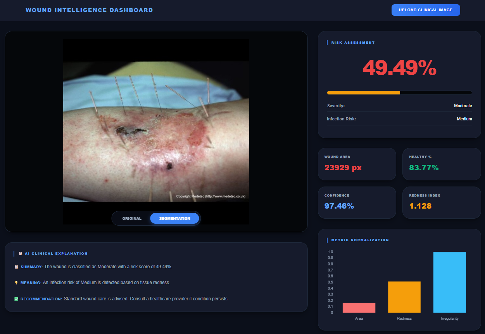

## 📊 Dashboard

---

## 🧪 Wound Analysis Results

### Sample 1

| Model Output | Wound Segmentation |
|-------------|------------------|
|  |  |

---

### Sample 2

| Model Output | Wound Segmentation |
|-------------|------------------|
|  |  |

---

## 🧠 What This Model Does

- Detects wound region using deep learning segmentation  
- Analyzes tissue characteristics (area, redness, irregularity)  
- Computes risk score and severity  
- Generates human-readable explanation  

---

## 📈 Model Performance

- Trained on: **1500 images**
- Tested on: **500 images**
- Task: **Wound Segmentation + Risk Assessment**
